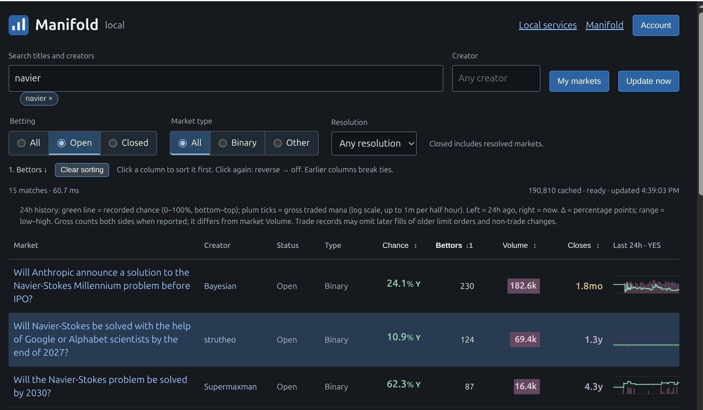

# Manifold local

Find Manifold markets, compare them at a glance, and read exactly what you would be betting on.

## Find the markets you care about

Search a local copy of more than 190,000 public market questions. Results appear as you type; the Navier–Stokes search shown above took 60.7 milliseconds.

Switch directly between **open and closed** markets or **binary and other** question types. Use **My markets** to find your own questions, or enter a username in **Creator** to browse someone else's. Choose **All** to include their closed markets as well.

Click any creator to add their username to your search. Small removable search chips let you drop a term or quoted phrase without editing the text.

## Compare without reading every number twice

- **Bettors first.** See how many distinct people have bet on each market, with the markets attracting the most bettors first by default. You can sort by volume instead.
- **Volume with visible scale.** Compact values such as `23k` save space. A plum bar behind each number grows with its magnitude, using the same scale across searches. Values keep their decimal place: `2.0k` does not look shorter than `1.1k`. Hover for the exact amount.
- **Time remaining.** See `4.0h`, `12.0d`, or `1.3y` in one line. Years, months, days, hours and minutes have distinct colors; the exact date is available on hover.
- **Aligned columns.** Creator, status, type, bettor counts, volume, chance and time remaining line up from row to row.
- **A stated side.** `90.3%Y` means a 90.3% chance of YES, with green numerals, percent sign and Y. Resolved YES and NO have gentle green and red labels.

Click the Chance, Bettors, Volume or Closes header to cycle ascending, descending and off. Combine columns to break ties; numbered arrows show their priority.

Recent binary-market activity appears as a 24-hour price sparkline with volume ticks and visible change, range and trade count. The shared scales make rows comparable. These are recorded trades; older limit-order fills and non-trade changes may be missing.

## Read the criteria before deciding

Select a question to fetch its current details, read the resolution criteria, and inspect individual answers. **Find related** starts an editable search for similar questions. **Open on Manifold** takes you to the original market.

This matters when similar titles describe different bets: a claimed solution, a correct proof made public, and a solution officially recognized by a deadline are different events.

The workshop keeps your own market drafts local while you work out the wording. Its criteria check highlights missing items to review; it does not decide whether the rules are sound. With an account connected, you can review a binary mana bet, a market publication, or a resolution of your own market before submitting it.

## Ready when you want it

On this computer, open [mm.localhost](http://mm.localhost), or choose **Manifold** from the Firefox new-tab page or local services list. It starts with the computer and checks for catalog updates about every two minutes. The page shows when the last update completed; this is not a guarantee that every value is less than two minutes old.

Searching needs no account connection. Account actions need a Manifold API key entered through **Account**; your Firefox login remains separate. Those actions are implemented, but have not yet been verified with a connected account.

[Setup and operation](docs/operations.md) · [Technical details](docs/architecture.md)
